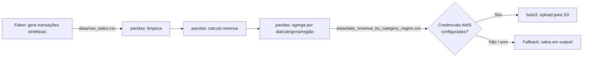

# ETL Pipeline em Python + AWS S3

Pipeline de ETL (Extract, Transform, Load) construído em Python puro + pandas,
com geração de dados sintéticos via `Faker` e carga opcional em um bucket
Amazon S3 via `boto3`.

Este é um projeto de **portfólio**: o objetivo é demonstrar, de forma clara e
legível, engenharia de dados de ponta a ponta — geração/ingestão de dados,
limpeza e transformação com pandas, e integração com um serviço de nuvem
(AWS S3) — sem a complexidade de um orquestrador de produção (Airflow,
Prefect, etc.), que seria excessivo para o escopo de uma demonstração.

> **Nenhum dado real é usado.** Todos os dados (produtos, clientes, regiões,
> preços) são gerados artificialmente com a biblioteca `Faker`. Não há
> referência a empresas, clientes ou empregadores reais.

## Arquitetura do pipeline

```
┌──────────────────┐     ┌───────────────────┐     ┌──────────────────────┐
│   1. EXTRACT      │     │   2. TRANSFORM     │     │   3. LOAD             │
│  generate_data.py │ ──▶ │   transform.py     │ ──▶ │   load_s3.py          │
│                    │     │                    │     │                       │
│  Faker gera ~1000  │     │  pandas: remove    │     │  boto3 envia o CSV    │
│  transações de     │     │  nulos/duplicatas, │     │  agregado para o S3.  │
│  venda sintéticas  │     │  calcula receita,  │     │  Sem credenciais AWS  │
│  → data/           │     │  agrega receita    │     │  configuradas, salva  │
│  raw_sales.csv     │     │  diária por        │     │  localmente em        │
│                    │     │  categoria/região  │     │  output/ (fallback).  │
└──────────────────┘     └───────────────────┘     └──────────────────────┘
```

Fluxo de dados:



## Estrutura do repositório

```
pipeline-etl-dados-aws/
├── src/
│   ├── generate_data.py   # Extract: gera dados sintéticos com Faker
│   ├── transform.py       # Transform: limpeza + agregação com pandas
│   ├── load_s3.py         # Load: upload para S3 (com fallback local)
│   └── pipeline.py        # Orquestra as 3 etapas em sequência
├── sample_data/
│   └── sample_raw_sales.csv   # Amostra de ~30 linhas, já commitada
├── requirements.txt
├── LICENSE
└── README.md
```

> Os arquivos `data/*.csv` (saída completa de ~1000 linhas) e `output/` não
> são versionados (ver `.gitignore`) — eles são gerados ao rodar o pipeline.
> O `sample_data/sample_raw_sales.csv` é uma amostra pequena e fixa, commitada
> propositalmente, para que qualquer pessoa visualize o formato dos dados sem
> precisar executar nada.

## Como executar

```bash
# 1. Clone o repositório e instale as dependências
git clone https://github.com/juniorgabisempre-dot/pipeline-etl-dados-aws.git
cd pipeline-etl-dados-aws
python -m venv .venv
source .venv/bin/activate  # Windows: .venv\Scripts\activate
pip install -r requirements.txt

# 2. Rode o pipeline completo (extract -> transform -> load)
python src/pipeline.py
```

Isso vai gerar `data/raw_sales.csv`, limpá-lo e agregá-lo em
`data/daily_revenue_by_category_region.csv`, e tentar enviar o resultado
para o S3.

### Rodando etapas isoladamente

```bash
python src/generate_data.py   # só gera os dados sintéticos
python src/transform.py       # só limpa e agrega (usa data/raw_sales.csv)
python src/load_s3.py         # só tenta a carga no S3 (ou fallback local)
```

## Integração com AWS S3

A etapa de carga (`load_s3.py`) é **opcional e automática**: o script detecta
se as credenciais AWS estão disponíveis e se comporta de acordo:

| Cenário | Comportamento |
|---|---|
| Variáveis de ambiente configuradas e upload bem-sucedido | Envia o CSV agregado para `s3://<S3_BUCKET_NAME>/sales/` |
| Variáveis de ambiente ausentes | Imprime um aviso e salva o arquivo em `output/` local |
| Credenciais inválidas / bucket inexistente / falha de rede | Captura o erro, imprime um aviso e salva em `output/` local |

Ou seja: **o pipeline sempre roda de ponta a ponta**, com ou sem uma conta AWS
configurada — o que é ideal tanto para quem quer só ver a lógica quanto para
quem quer testar a integração real.

Para habilitar o upload real, defina as variáveis de ambiente antes de rodar
o pipeline:

```bash
export AWS_ACCESS_KEY_ID="sua-access-key"
export AWS_SECRET_ACCESS_KEY="sua-secret-key"
export S3_BUCKET_NAME="seu-bucket-s3"
```

(No Windows/PowerShell: `$env:AWS_ACCESS_KEY_ID = "..."`, etc.)

**Use suas próprias credenciais e um bucket de teste** — este projeto não
inclui nem assume nenhuma credencial ou bucket específico.

## O que este projeto demonstra

- **Engenharia de dados em Python**: separação clara de responsabilidades
  entre extração, transformação e carga (padrão ETL).
- **Manipulação de dados com pandas**: limpeza (nulos, duplicatas), criação
  de colunas derivadas, agregações com `groupby`.
- **Geração de dados sintéticos** com `Faker`, incluindo imperfeições
  propositais (nulos, duplicatas) para simular dados reais.
- **Integração com AWS (S3)** via `boto3`, incluindo tratamento de erro e
  estratégia de fallback — uma prática comum em pipelines de produção.
- **Código legível e sem dependências desnecessárias**: sem orquestrador
  externo, sem abstrações que o escopo do projeto não pede.

## Licença

Distribuído sob a licença MIT — veja [LICENSE](LICENSE).
